<div align="center">


# Student Dropout XAI

**Predict student dropout, explain every prediction, and audit the model for fairness.**

An explainable-AI project and full-stack web app built on the UCI *Predict Students' Dropout and Academic Success* dataset.


[Overview](#overview) ·
[Key findings](#key-findings) ·
[Screenshots](#screenshots) ·
[Quick start](#quick-start) ·
[API](#api-reference) ·
[Deployment](#deployment-on-vercel) ·
[Limitations](#limitations-and-responsible-use) ·
[FAQ](#faq)

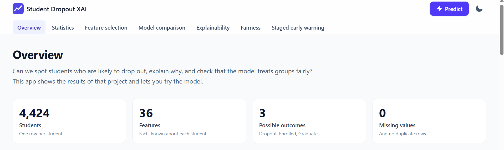

</div>

### At a glance

| 4,424 | 36 | 3 | 6 | 8 | 9 | 21 |
|:---:|:---:|:---:|:---:|:---:|:---:|:---:|
| students | features | outcomes | XGBoost models (3 stages × aware/blind) | app pages | API endpoints | backend test functions |

---

## Table of contents

- [Overview](#overview)
- [Key findings](#key-findings)
- [What the app does](#what-the-app-does)
- [Try it in 60 seconds](#try-it-in-60-seconds)
- [Screenshots](#screenshots)
- [Detailed results](#detailed-results)
- [How it works](#how-it-works)
- [Tech stack](#tech-stack)
- [Quick start](#quick-start)
- [API reference](#api-reference)
- [Testing](#testing)
- [Deployment on Vercel](#deployment-on-vercel)
- [Project structure](#project-structure)
- [Modelling notes](#modelling-notes)
- [The 36 features](#the-36-features)
- [Notebook guide](#notebook-guide)
- [Limitations and responsible use](#limitations-and-responsible-use)
- [Dataset and citation](#dataset-and-citation)
- [Glossary](#glossary)
- [FAQ](#faq)
- [Troubleshooting](#troubleshooting)
- [Roadmap](#roadmap)
- [Further documentation](#further-documentation)
- [Author and acknowledgements](#author-and-acknowledgements)
- [License](#license)

---

## Overview

Universities want to spot students who may drop out early enough to help them. A model that predicts dropout is only useful if people can **understand why** it flags a student and **trust that it treats groups fairly**.

This project answers three questions on 4,424 students from a Portuguese higher-education institution:

1. **How well can dropout be predicted, and which model is really best?** Five models are compared with the Friedman test and a Nemenyi post-hoc test.
2. **Why does the model predict what it does?** Explained globally and per student with **SHAP** and **LIME**.
3. **Is it fair, and how early can it warn?** Error rates and explanations are audited by gender, age and nationality, at three points in time: *at enrollment*, *after semester 1* and *after semester 2*.

The work started as a Jupyter notebook (`student_dropout_xai.ipynb`) and is now delivered as a web app with eight pages: seven results pages plus a **live prediction page** where you enter a student's details and get a risk estimate with reasons.

---

## Key findings

| Topic | Result |
|---|---|
| **Best model** | XGBoost ranks best in the Friedman test (χ² = 31.12, p < 0.001, mean rank 1.1, macro-F1 0.713). Its lead over Random Forest is **not** statistically significant, but it is clearly better than SVM, Logistic Regression and the Decision Tree. |
| **Test-set quality** | Accuracy 0.769. Graduates and dropouts are found well (F1 0.86 and 0.77). The *Enrolled* group is hard to predict (F1 0.48). |
| **Strongest signals** | Subjects approved in the first two semesters, tuition fees being up to date, scholarship, debt, and age at enrollment. |
| **How early can it warn?** | At enrollment the model is weak (Dropout AUC ≈ 0.77, about 56% of dropouts caught when flagging the riskiest 30%). After semester 1 it is much better (AUC ≈ 0.91, 74% caught). After semester 2 it reaches AUC ≈ 0.93 and 77% caught. |
| **Fairness gaps shrink as data arrives** | The recall gap between age groups falls from 0.64 at enrollment to 0.25 after semester 2, and the gap between genders falls from 0.27 to 0.06. Both changes are statistically real. Nationality shows no significant change, but only 110 students are non-Portuguese. |
| **The reasons change over time** | At enrollment, sensitive attributes (age, gender, nationality, international status) carry about 29% of the model's total SHAP importance. After semester 2 this is about 9%, because grades take over. |
| **A gap remains** | Even after semester 2, young students who drop out are still caught less often than older ones, and removing age from the model does not fully close the gap, because other features act as proxies. |

> Numbers shown in the app come from `artifacts/`. They differ slightly from the notebook because of library versions (see [Modelling notes](#modelling-notes) and [`docs/DEVIATIONS.md`](docs/DEVIATIONS.md)).

---

## What the app does

| Page | What you find there |
|---|---|
| **Overview** | Dataset summary, class balance, the project pipeline and a plain-language glossary. |
| **Statistics** | Every feature tested against the outcome (chi-square and Kruskal-Wallis, with effect sizes and multiple-testing correction). |
| **Feature selection** | Three methods (filter, embedded, wrapper) vote for the 15 most useful features. |
| **Model comparison** | Five models compared with the Friedman test, Nemenyi post-hoc test and a critical-difference diagram. |
| **Explainability** | SHAP (global and per student), LIME (per student, including interactive HTML) and how the two compare. |
| **Fairness** | Error rates and feature reliance by gender, age group and nationality, with significance tests and mitigation experiments. |
| **Staged early warning** | How accuracy, fairness gaps and explanations change at enrollment, after semester 1 and after semester 2. |
| **Predict** | Enter a student's details, pick the stage, and get probabilities, a risk percentile, an at-risk flag, a reliability warning and SHAP and LIME explanations. |

The app also has a light and dark theme, loading and error states, and labelled form fields.

---

## Try it in 60 seconds

1. Open the **Predict** page (the highlighted button in the top bar).
2. Pick a stage: **At enrollment**, **After semester 1** or **After semester 2**. Each stage shows only the fields the university would know by then, and values you enter are kept when you switch.
3. Click **Typical Dropout**, **Typical Graduate** or **Random real student** to fill the form with a real student from the dataset, or type your own values.
4. Press **Predict** (or leave **Update automatically** ticked) and read the result.
5. Switch to **After semester 2** and watch the reliability warning disappear and the prediction sharpen.
6. Turn on **Hide sensitive attributes** to use the blind model, trained without age, gender, nationality and international status, and compare the result.
7. Press **Explain with LIME** for a second opinion on the same student (it takes a few seconds).

### How to read the result

| What you see | What it means |
|---|---|
| **Probability bars** | The model's estimate for Dropout, Enrolled and Graduate. They add up to 100%. |
| **Risk gauge and percentile** | "Riskier than X% of past students at this stage." Compares the student with all 4,424 students, using each stage's own model. |
| **At-risk flag** | Set when the student is in the riskiest 30% at that stage. |
| **Reliability banner** | Shows how trustworthy the stage is. At enrollment it warns that **predictions at this stage are weak**. |
| **SHAP contributions** | Which features push the dropout risk **up** or **down** for this student, with a plain-language sentence for each. |
| **LIME explanation** | A second, independent explanation. If SHAP and LIME point the same way, you can be more confident. They agree only partly on average, so treat differences as a prompt to look closer. |

---

## Screenshots

### Overview

The landing page summarises the dataset and links to every step of the project.


<table>
<tr>
<td width="50%" valign="top">

**Class balance.** Half the students graduate, about a third drop out and 18% are still enrolled, which is why models are scored with macro-F1.

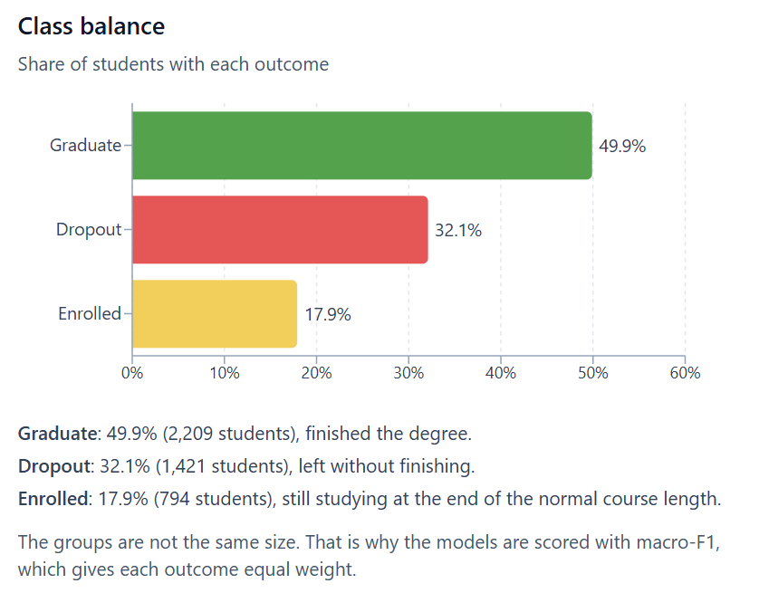

</td>
<td width="50%" valign="top">

**Project pipeline.** Nine steps from data cleaning to the live prediction app. Each step opens its page.

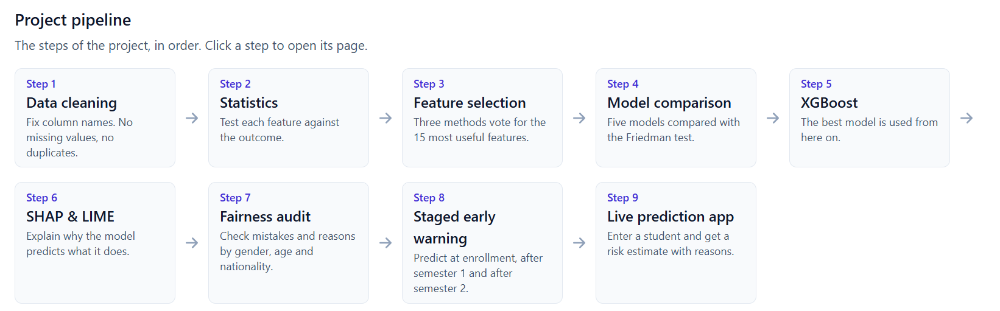

</td>
</tr>
</table>

### Statistics

Dropout rates split by tuition status, scholarship, debt and gender. Students who are behind on tuition drop out far more often.

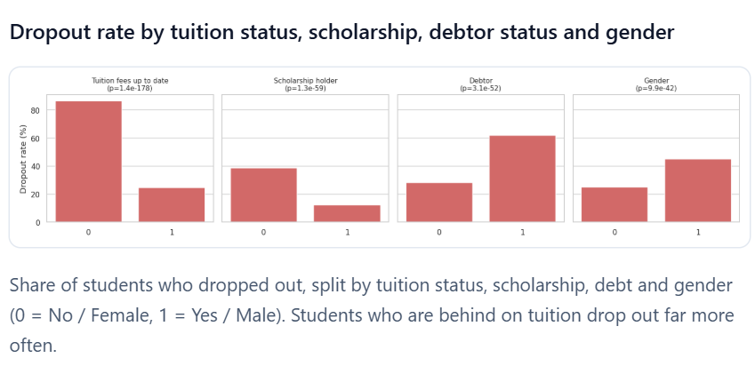

The strongest numeric feature, subjects approved in semester 2, by outcome.

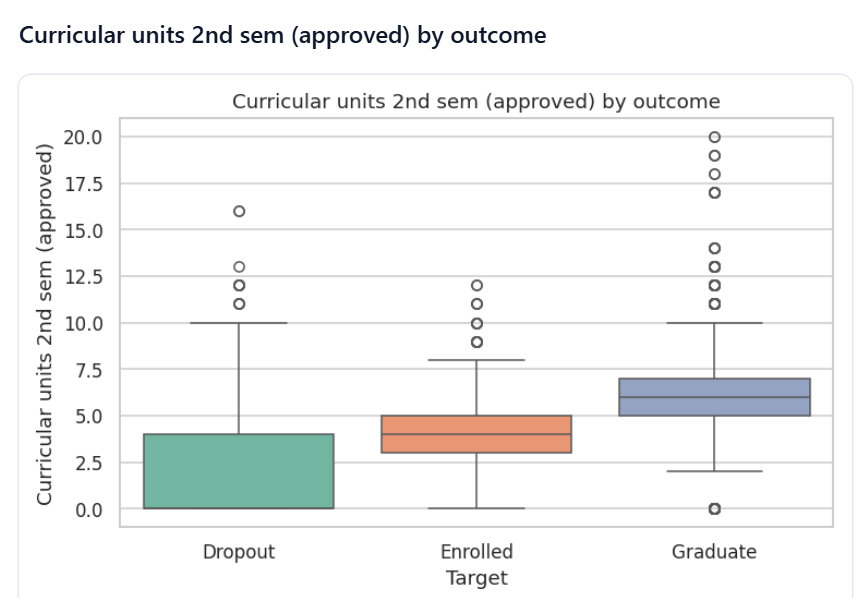

### Model comparison

Five common models are tested the same way. The **Friedman test** asks whether the differences are real or just luck of the data split.

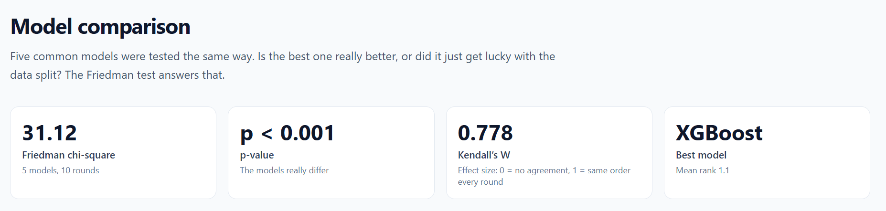

<table>
<tr>
<td width="50%" valign="top">

**Average score** (macro-F1 over 10 cross-validation rounds).

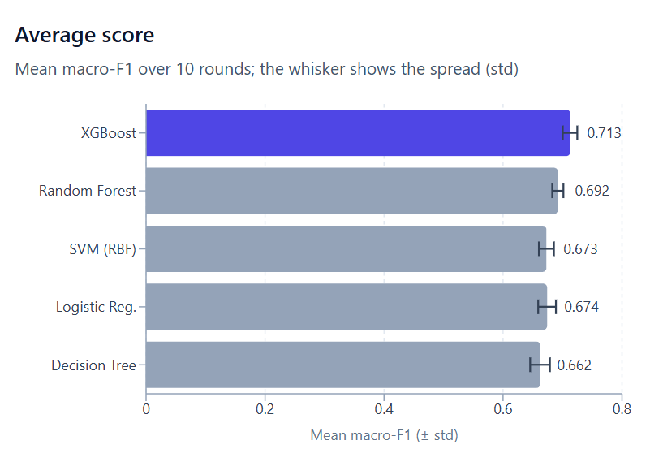

</td>
<td width="50%" valign="top">

**Average rank** (1 = best in a round).

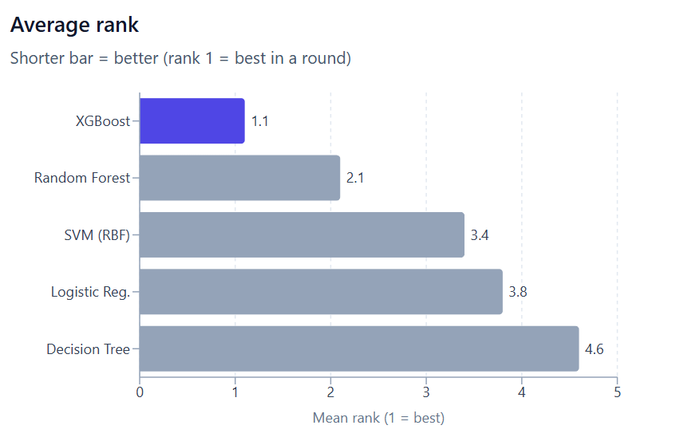

</td>
</tr>
</table>

The **Nemenyi follow-up test** shows which models are significantly worse than XGBoost.

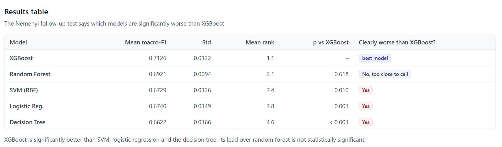

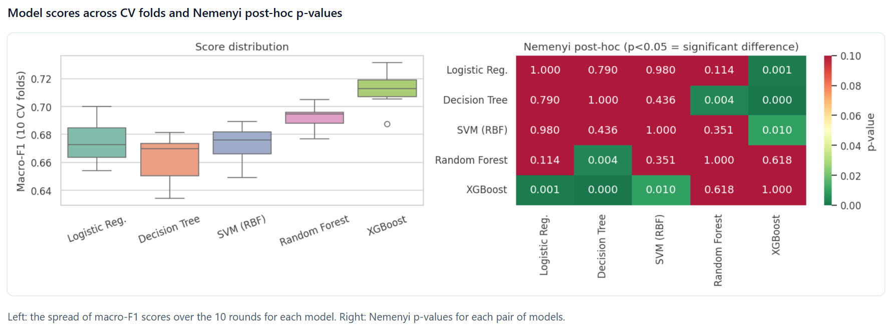

Models joined by a bar in the **critical-difference diagram** are not significantly different.

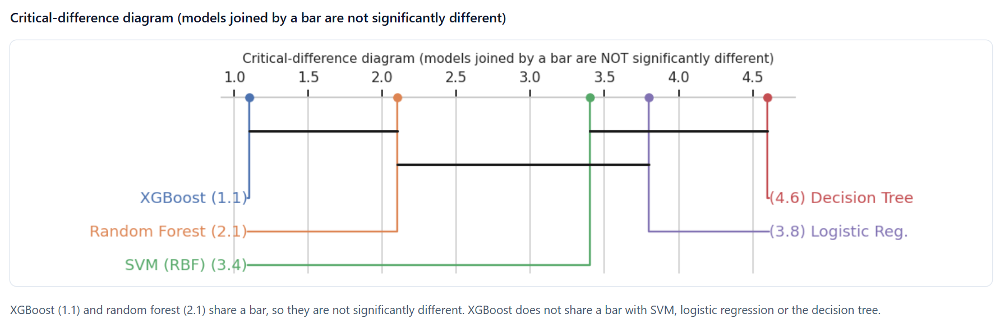

Final model performance on the held-out test set.

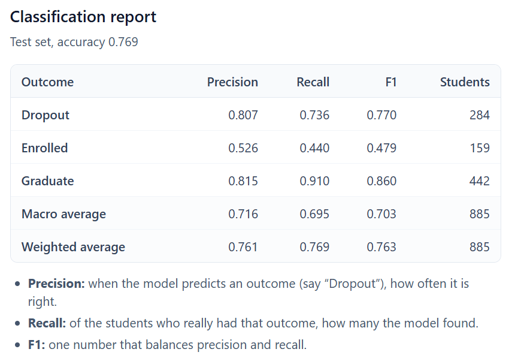

### Explainability

SHAP and LIME answer the same question in different ways. This table explains when to use which.

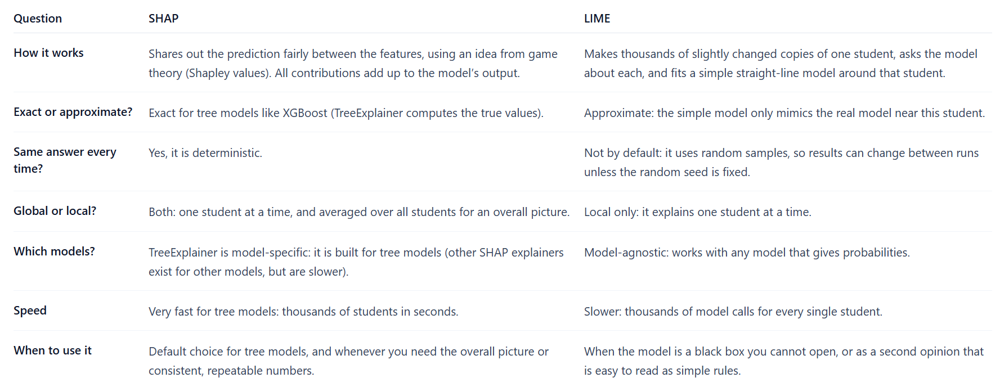

### Fairness

Where does the model lean on different features for different groups? Age at enrollment and gender show the largest differences.

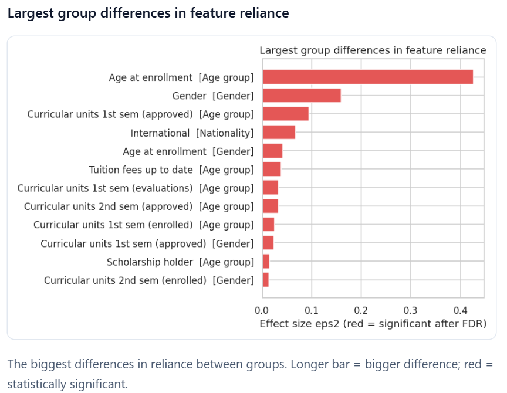

### Staged early warning

Do the fairness gaps shrink as more information becomes available? For age and gender, yes. Rows in green are changes whose 95% interval excludes zero.

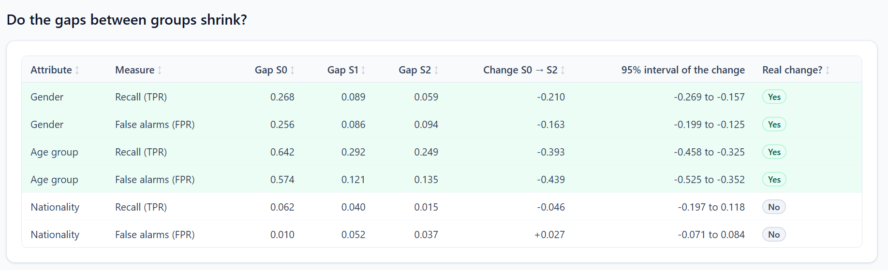

### Live prediction

Choose a stage, enter a student's details (or load a typical example) and get a prediction with a risk gauge, a percentile among past students and an at-risk flag.

<div align="center">

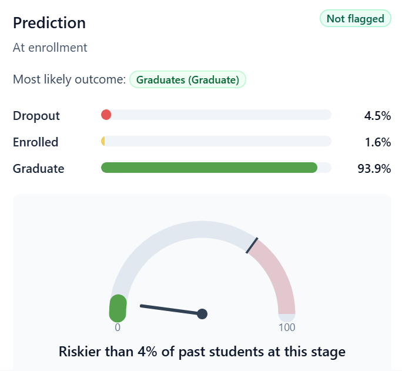

</div>

---

## Detailed results

All figures below come from the files in this repository (`artifacts/` and the result CSVs served by the API).

### Model comparison

Ten cross-validation rounds, macro-F1. Friedman χ² = 31.12, p < 0.001, Kendall's W = 0.778. The *p vs XGBoost* column is the Nemenyi post-hoc test.

| Model | Mean macro-F1 | Std | Mean rank | p vs XGBoost | Clearly worse than XGBoost? |
|---|---:|---:|---:|---:|---|
| **XGBoost** | 0.7126 | 0.0122 | 1.1 | n/a | Best model |
| Random Forest | 0.6921 | 0.0094 | 2.1 | 0.618 | No, too close to call |
| SVM (RBF) | 0.6729 | 0.0126 | 3.4 | 0.010 | Yes |
| Logistic Regression | 0.6740 | 0.0149 | 3.8 | 0.001 | Yes |
| Decision Tree | 0.6622 | 0.0166 | 4.6 | < 0.001 | Yes |

Held-out test set (885 students), final model: accuracy **0.769**, macro-F1 **0.703**. Dropout F1 0.770, Graduate F1 0.860, Enrolled F1 0.479.

### How early can the model warn?

Out-of-fold results for the standard (aware) model at each stage. "Dropouts caught" is the share of real dropouts inside the riskiest 30% of students.

| Stage | When | Features | Accuracy | Macro-F1 | Dropout AUC | Dropouts caught (top 30%) | Precision (top 30%) |
|---|---|---|---|---|---|---|---|
| 0 | At enrollment | 22 | 0.618 | 0.508 | 0.774 | 56% | 60% |
| 1 | After semester 1 | 30 | 0.751 | 0.670 | 0.905 | 74% | 79% |
| 2 | After semester 2 | 36 | 0.780 | 0.708 | 0.927 | 77% | 82% |

### Who gets caught? Recall by group and stage

Share of real dropouts that were flagged, by group. Gaps are large at enrollment and shrink once grades arrive, but a gap for young students remains.

| Attribute | Group | Students | At enrollment | After semester 1 | After semester 2 |
|---|---|---:|---:|---:|---:|
| Gender | Female | 2,868 | 42% | 69% | 73% |
| Gender | Male | 1,556 | 71% | 79% | 80% |
| Age group | ≤20 | 2,551 | 26% | 60% | 64% |
| Age group | 21-24 | 735 | 48% | 69% | 74% |
| Age group | 25-29 | 427 | 86% | 89% | 87% |
| Age group | 30+ | 711 | 84% | 88% | 89% |
| Nationality | Portuguese | 4,314 | 56% | 74% | 77% |
| Nationality | Non-Portuguese | 110 | 53% | 81% | 78% |

> The Non-Portuguese group has only 110 students, so its numbers are very uncertain. See the confidence bands in the app.

### Do the gaps change between stages?

The gap is the largest difference between groups. A change is "real" when its 95% bootstrap interval excludes zero.

| Attribute | Measure | Gap S0 | Gap S1 | Gap S2 | Change S0 → S2 | 95% interval | Real change? |
|---|---|---:|---:|---:|---:|---|---|
| Gender | Recall (missed dropouts) | 0.268 | 0.089 | 0.059 | -0.210 | -0.269 to -0.157 | **Yes** |
| Gender | False alarms | 0.256 | 0.086 | 0.094 | -0.163 | -0.199 to -0.125 | **Yes** |
| Age group | Recall (missed dropouts) | 0.642 | 0.292 | 0.249 | -0.393 | -0.458 to -0.325 | **Yes** |
| Age group | False alarms | 0.574 | 0.121 | 0.135 | -0.439 | -0.525 to -0.352 | **Yes** |
| Nationality | Recall (missed dropouts) | 0.062 | 0.040 | 0.015 | -0.046 | -0.197 to 0.118 | No |
| Nationality | False alarms | 0.010 | 0.052 | 0.037 | +0.027 | -0.071 to 0.084 | No |

### Does removing sensitive attributes help?

Retraining without age, gender, nationality and international status (the "blind" model) narrows some gaps, mostly at enrollment, but does not remove them. Other features act as proxies. Nationality results are noisy because the group is small.

| Stage | Variant | Dropout AUC | Dropouts caught | Gender gap | Age gap | Nationality gap |
|---|---|---:|---:|---:|---:|---:|
| S0 enrollment | with sensitive attributes | 0.772 | 56% | 0.268 | 0.642 | 0.062 |
| S0 enrollment | without sensitive attributes | 0.763 | 55% | 0.112 | 0.504 | 0.042 |
| S1 after sem 1 | with sensitive attributes | 0.906 | 74% | 0.089 | 0.292 | 0.040 |
| S1 after sem 1 | without sensitive attributes | 0.906 | 74% | 0.040 | 0.252 | 0.106 |
| S2 after sem 2 | with sensitive attributes | 0.926 | 77% | 0.059 | 0.249 | 0.015 |
| S2 after sem 2 | without sensitive attributes | 0.925 | 76% | 0.027 | 0.227 | 0.050 |

<details>
<summary><b>Strongest links with the outcome (statistics)</b></summary>

<br>

Each feature is tested against the outcome. **31 of 36** features are significant after Benjamini-Hochberg correction, so effect size is what separates them.

| Rank | Feature | Test | Effect size |
|---:|---|---|---:|
| 1 | Tuition fees up to date | Chi-square (Cramér’s V) | 0.431 |
| 2 | Curricular units 2nd sem (approved) | Kruskal-Wallis (ε²) | 0.428 |
| 3 | Curricular units 1st sem (approved) | Kruskal-Wallis (ε²) | 0.353 |
| 4 | Curricular units 2nd sem (grade) | Kruskal-Wallis (ε²) | 0.314 |
| 5 | Scholarship holder | Chi-square (Cramér’s V) | 0.304 |
| 6 | Course | Chi-square (Cramér’s V) | 0.251 |
| 7 | Curricular units 1st sem (grade) | Kruskal-Wallis (ε²) | 0.247 |
| 8 | Debtor | Chi-square (Cramér’s V) | 0.242 |
| 9 | Gender | Chi-square (Cramér’s V) | 0.230 |
| 10 | Application mode | Chi-square (Cramér’s V) | 0.230 |

Full table: `statistical_tests.csv`, also shown on the Statistics page.

</details>

<details>
<summary><b>Mitigation experiment (notebook, section 9.8)</b></summary>

<br>

Using a separate decision threshold for each group, tuned on one random half of the students and evaluated on the other half, so the result is not over-optimistic.

| Attribute | Rule | Recall gap | False-alarm gap | F1 | Accuracy |
|---|---|---:|---:|---:|---:|
| Gender | Single threshold (0.5) | 0.055 | 0.086 | 0.791 | 0.878 |
| Gender | Group thresholds | 0.003 | 0.047 | 0.794 | 0.879 |
| Age group | Single threshold (0.5) | 0.286 | 0.086 | 0.791 | 0.878 |
| Age group | Group thresholds | 0.149 | 0.065 | 0.762 | 0.854 |
| Nationality | Single threshold (0.5) | 0.057 | 0.039 | 0.791 | 0.878 |
| Nationality | Group thresholds | 0.052 | 0.014 | 0.793 | 0.878 |

Closing the gender gap is almost free. Narrowing the age gap costs about three points of F1 and two to three points of accuracy. Using a protected attribute to set thresholds is also a form of unequal treatment, so this is a trade-off to discuss and not a recommendation.

</details>

<details>
<summary><b>SHAP and LIME agreement (notebook, section 8)</b></summary>

<br>

For 40 test students, the top-10 features from SHAP and LIME overlap by **0.59** on average (Jaccard, range 0.43 to 0.82), and their rankings correlate at **0.42** (Spearman). The two methods agree on the broad picture but often disagree on the details, so use them as complementary views.

</details>

---

## How it works

### Pipeline

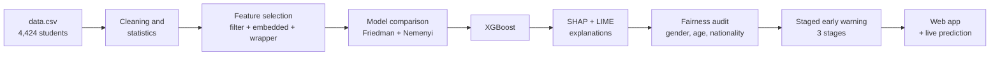

### Three stages, three models

A real early-warning system can only use what is known **at that moment**, so the app has one model per stage, each with a "blind" variant that leaves out sensitive attributes.

| Stage | When | Features | Information available |
|---|---|---|---|
| **0** | At enrollment | 22 | Personal data, family background, application and prior education, scholarship, economic context |
| **1** | After semester 1 | 30 | Stage 0 plus semester-1 results, debtor status and tuition status |
| **2** | After semester 2 | 36 | Stage 1 plus semester-2 results |

*Blind* models drop `Age at enrollment`, `Gender`, `Nationality` and `International`. That gives six XGBoost models in total.

### At-risk flag

For a fair comparison between stages, a student is **flagged at risk** when their predicted dropout probability is in the **top 30%** of all past students at that stage (a fixed support capacity, close to the 32% true dropout rate). The percentile shown in the app uses 5-fold out-of-fold predictions for all 4,424 students.

### Methods in plain words

- **Friedman test:** ranks the models inside every cross-validation round and tests whether the average ranks differ more than chance would allow. **Nemenyi** then shows which pairs differ.
- **SHAP:** shares a prediction fairly between the features (an idea from game theory). Exact and repeatable for tree models, for one student or averaged over everyone.
- **LIME:** makes many slightly changed copies of one student and fits a simple model around that student. Model-agnostic, but approximate and random unless the seed is fixed.
- **Fairness measures:** *equal opportunity* (are real dropouts caught equally often in every group?) and *false-alarm rate*, tested with permutation tests and bootstrap intervals.

### Architecture

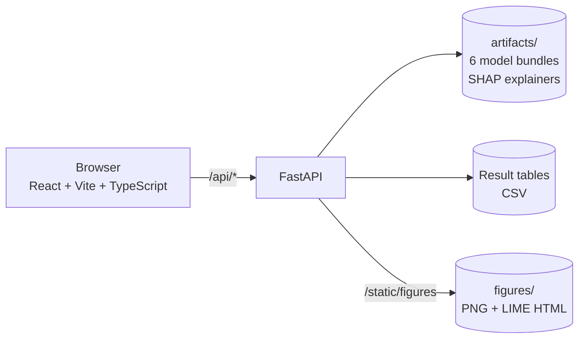

---

## Tech stack

| Layer | Technologies |
|---|---|
| **Backend** | Python 3.13, FastAPI, Pydantic v2, Uvicorn |
| **Machine learning** | XGBoost, scikit-learn, pandas, NumPy, SciPy |
| **Explainability** | SHAP (`TreeExplainer`), LIME (`LimeTabularExplainer`) |
| **Frontend** | React 19, TypeScript, Vite 8, Tailwind CSS 4, React Router 7, TanStack Query, Recharts |
| **Testing** | pytest, httpx (21 test functions, several run across every stage and variant) |
| **Deployment** | Vercel (one project serves the API and the built frontend) |

---

## Quick start

### Prerequisites

- **Python 3.13** (the pinned versions in `backend/requirements.txt` were trained with it)
- A current **Node.js LTS** with npm
- Git

### 1. Clone

```bash
git clone https://github.com/ARSHIKA-SINGH/student-dropout-xai.git
cd student-dropout-xai
```

### 2. Start the backend (port 8000)

```bash
python -m venv backend/.venv

# macOS / Linux
source backend/.venv/bin/activate
# Windows (PowerShell)
backend\.venv\Scripts\Activate.ps1

pip install -r backend/requirements.txt
uvicorn backend.main:app --reload --port 8000
```

- Health check: <http://localhost:8000/api/health>
- Interactive API docs: <http://localhost:8000/docs>
- Run the command from the **repository root**, because the import path is `backend.main:app`.

The trained models are already in `artifacts/`. Retrain only if you change the training code (takes about a minute or two):

```bash
python backend/train.py
```

### 3. Start the frontend (port 5173)

In a second terminal:

```bash
cd frontend
npm install
npm run dev
```

Open <http://localhost:5173>. The port is strict: if it is busy, free it or start Vite on another port with `npx vite --port 5174` (the backend accepts any localhost port).

To point the frontend at a different API address:

```bash
VITE_API_URL=http://localhost:9000 npm run dev
```

### 4. Production build (optional)

```bash
cd frontend
npm run build      # output in frontend/dist
npm run preview    # http://localhost:4173, forwards /api and /static to port 8000
npm run typecheck
```

Once `frontend/dist` exists, the backend also serves the built app itself at <http://localhost:8000>.

---

## API reference

All endpoints return JSON. Full contract: [`docs/CONTRACT.md`](docs/CONTRACT.md).

| Method | Endpoint | Description |
|---|---|---|
| `GET` | `/api/health` | Service status and whether all six models are loaded |
| `GET` | `/api/metadata` | Feature definitions, labels, allowed values, stages and model metrics |
| `POST` | `/api/predict` | Prediction, risk percentile, at-risk flag, SHAP contributions and reliability |
| `POST` | `/api/explain/lime` | LIME explanation for the same input (takes a few seconds) |
| `GET` | `/api/example` | A real example student. Query: `cls` (`Graduate`, `Dropout`, `Enrolled`, `random`), `typical`, `seed` |
| `GET` | `/api/results/tables` | Names of the available result tables |
| `GET` | `/api/results/tables/{name}` | One result table as JSON (statistics, fairness, staged results) |
| `GET` | `/api/results/figures` | Catalogue of notebook figures and LIME HTML files |
| `GET` | `/api/results/{name}` | Stage results: `stage_group_metrics`, `stage_shap_shares` |
| `GET` | `/static/figures/*` | The figure files themselves |

### Example: predict a student

```bash
# 1. Get a real example student
curl "http://localhost:8000/api/example?cls=Dropout"

# 2. Predict. Paste the "features" object from step 1.
#    stage: 0 = at enrollment, 1 = after semester 1, 2 = after semester 2
#    blind: true hides age, gender, nationality and international status
curl -X POST http://localhost:8000/api/predict \
  -H "Content-Type: application/json" \
  -d '{"stage": 2, "blind": false, "features": { ... }}'
```

The response contains:

| Field | Meaning |
|---|---|
| `probabilities` | Probability of Dropout, Enrolled and Graduate |
| `predicted_class` | The most likely outcome |
| `dropout_percentile` | Share of past students with a lower dropout probability at this stage |
| `flagged_at_risk` / `flag_threshold` | Whether the student is in the riskiest 30%, and the cut-off used |
| `shap` | Top feature contributions toward dropout, with plain-language labels and direction |
| `reliability` | The stage's AUC and share of dropouts caught, so the UI can warn that early predictions are weak |

Invalid input returns a `422` response that lists every problem at once.

---

## Testing

```bash
pytest backend/tests -q
```

The 21 test functions (several parametrised across stages, variants and classes) cover health and metadata, valid predictions for every stage and variant, validation errors (including out-of-range and huge values), blind-mode input, LIME, example students, result tables and figures, CORS and consistency of the at-risk flag near the cut-off.

---

## Deployment on Vercel

One Vercel project serves both parts from a single URL: the FastAPI app runs as a Python function and also serves the built React app, so there is no CORS setup and no API URL to configure.

1. Import the GitHub repository at <https://vercel.com/new>.
2. Leave **Root Directory** at the repository root (`./`). Vercel detects FastAPI.
3. No environment variables are needed. Every push to `main` redeploys.

Do **not** deploy `backend/` or `frontend/` as separate projects: the backend reads `artifacts/`, `figures/` and the CSV files from the repository root, and a frontend deployed alone has no API.

`pyproject.toml` lists the runtime packages (using `xgboost-cpu` on Linux to stay under Vercel's size limit) and `vercel.json` builds the frontend and excludes tests, docs and the notebook from the function.

---

## Project structure

```
student-dropout-xai/
├── backend/
│   ├── main.py              FastAPI app and endpoints
│   ├── train.py             trains the models and writes artifacts/
│   ├── data/                official UCI variable table used for code labels
│   └── tests/               pytest API tests
├── frontend/
│   └── src/
│       ├── pages/           8 pages (Overview ... Predict)
│       ├── components/      shared UI components
│       ├── api/             typed API client and TanStack Query hooks
│       └── theme/           light and dark theme
├── artifacts/               model bundles (.joblib), metadata, metrics, examples
├── figures/                 notebook plots (PNG) and LIME HTML files
├── docs/                    SPEC, CONTRACT, DEVIATIONS, RUN, FRONTEND_GUIDE
├── Screenshots/             app screenshots used in this README
├── *.csv                    notebook result tables served by the API
├── data.csv                 UCI dataset
├── student_dropout_xai.ipynb   the original analysis notebook
├── pyproject.toml, vercel.json deployment configuration
└── README.md
```

---

## Modelling notes

<details>
<summary><b>Expand for details on models, explainers and reproducibility</b></summary>

- **Models.** All six models are `XGBClassifier(n_estimators=150, max_depth=4, learning_rate=0.1, subsample=0.8, colsample_bytree=0.8, random_state=42)`.
- **Served models** are fit on a stratified 80% training split (`random_state=42`). `artifacts/model_metrics.json` holds hold-out accuracy, macro-F1 and Dropout AUC on the remaining 20% (885 students), plus out-of-fold metrics.
- **Percentile and flag** use 5-fold out-of-fold predictions for all 4,424 students (StratifiedKFold, shuffled, `random_state=42`). The flag threshold is the 70th percentile of those scores.
- **SHAP** `TreeExplainer` is stored inside each model bundle.
- **LIME** cannot be pickled, so each bundle stores its training split and the API rebuilds the explainer at startup (`discretize_continuous=True`, `random_state=42`). The same input always gives the same explanation.
- **Example students.** The "typical" Graduate or Dropout is the real student whose out-of-fold probability is the median among correctly predicted students of that class.
- **Code labels.** Coded columns (course, application mode, parents' occupation and so on) are labelled from the official UCI variables table, saved in `backend/data/uci_variables.json`. Every code in `data.csv` was checked against it.
- **Differences from the notebook.** The app runs on newer library versions than the notebook, so numbers drift slightly: overall AUC and recall within 0.009, group recalls within 0.031 (one student in the smallest group). Conclusions are unchanged. Every deviation is listed in [`docs/DEVIATIONS.md`](docs/DEVIATIONS.md).

</details>

---

## The 36 features

<details>
<summary><b>Expand the feature dictionary</b></summary>

<br>

An asterisk marks the four sensitive attributes removed in the "blind" models.

| Family | Available from | Features |
|---|---|---|
| **Personal** | Enrollment | Marital status, Nationality \*, Displaced, Educational special needs, Gender \*, Age at enrollment \*, International \* |
| **Application and prior education** | Enrollment | Application mode, Application order, Course, Daytime/evening attendance, Previous qualification, Previous qualification (grade), Admission grade |
| **Family background** | Enrollment | Mother's qualification, Father's qualification, Mother's occupation, Father's occupation |
| **Scholarship** | Enrollment | Scholarship holder |
| **Economy** | Enrollment | Unemployment rate, Inflation rate, GDP |
| **Finance (assumed later)** | After semester 1 | Debtor, Tuition fees up to date |
| **Semester 1 results** | After semester 1 | Curricular units 1st sem: credited, enrolled, evaluations, approved, grade, without evaluations |
| **Semester 2 results** | After semester 2 | Curricular units 2nd sem: credited, enrolled, evaluations, approved, grade, without evaluations |

Coded columns (such as course or occupation) are shown with readable labels in the app, taken from the official UCI variables table. The dataset does not document when `Debtor` and `Tuition fees up to date` become known, so they are assumed to be unknown at enrollment.

</details>

---

## Notebook guide

`student_dropout_xai.ipynb` holds the full analysis. The web app displays its results and re-implements its models for live prediction.

| Section | What it does |
|---|---|
| 1. Load and clean | Fixes column names, checks for missing values and duplicates, encodes the three outcomes |
| 2. Statistical analysis | Chi-square and Kruskal-Wallis tests, effect sizes, Benjamini-Hochberg correction, Dunn's post-hoc test |
| 3. Feature selection | Filter (mutual information), embedded (random-forest importance) and wrapper (RFE) methods, combined by voting |
| 4. Model comparison | Five models, 5×2 repeated cross-validation, Friedman test, Nemenyi post-hoc test, critical-difference diagram |
| 4b. Feature-set comparison | A second Friedman test: do 15 selected features match all 36? |
| 5. Final model | XGBoost on the consensus features, classification report and confusion matrix |
| 6. SHAP | Bar, beeswarm, dependence and waterfall plots |
| 7. LIME | Per-student explanations, with interactive HTML |
| 8. SHAP vs LIME | Overlap and rank-correlation of the two explanations |
| 9. Fairness audit | Error rates by group, permutation tests, SHAP by group, matched age comparison, proxy check, mitigation |
| 10. Staged early warning | The three-stage analysis: group gaps, SHAP shares and blind models at each stage |
| 11. Conclusions | Template for your own written conclusions |

**To re-run it:** keep `data.csv` next to the notebook and install the extra analysis packages first (the notebook also uses `scikit-posthocs`, `statsmodels` and `seaborn`, which the web backend does not need):

```bash
pip install shap lime xgboost scikit-learn scikit-posthocs statsmodels seaborn matplotlib jupyter
jupyter notebook student_dropout_xai.ipynb
```

It writes the plots to `figures/` and the result tables to the repository root.

---

## Limitations and responsible use

> **This is an educational project. Do not use it for real admissions, grading or student-support decisions.**

- **One institution.** The data come from a single Portuguese institution, so results may not generalise to other universities or countries.
- **Prediction is not causation.** SHAP and LIME describe what the *model* uses, not what *causes* students to drop out.
- **Early predictions are weak.** At enrollment the model is much less accurate and less fair than after one or two semesters. The app shows a warning for this.
- **Timing is assumed.** The dataset does not say when debtor status and tuition status become known, so they are treated as unknown at enrollment.
- **The *Enrolled* outcome is not final.** Those students have not yet graduated or dropped out, and the model finds them hardest to predict.
- **Small groups.** Only 110 students are non-Portuguese, so nationality results have wide uncertainty and cannot show that the model is fair for that group.
- **A fairness gap remains.** Young dropouts are still caught less often than older ones after semester 2. Removing sensitive features helps only partly, because other features act as proxies.
- **Mitigation has costs.** Group-specific thresholds reduce the gap but lower overall accuracy, and treating groups differently can itself raise legal and ethical issues.
- **Differences may be real.** Different error rates between groups can reflect real differences in the data, not only model bias.

---

## Dataset and citation

Data: **Predict Students' Dropout and Academic Success**, UCI Machine Learning Repository. 4,424 students, 36 features, three outcomes (Dropout, Enrolled, Graduate), no missing values. Collected at the Polytechnic Institute of Portalegre, Portugal.

- Dataset page: <https://archive.ics.uci.edu/dataset/697/predict+students+dropout+and+academic+success>
- Please cite the dataset as described on that page, and check its license terms before reuse.

---

## Glossary

| Term | Plain-language meaning |
|---|---|
| **Out-of-fold prediction** | A prediction made by a model that never saw that student during training. Used for honest percentiles and group results. |
| **Macro-F1** | One score that gives Dropout, Enrolled and Graduate equal weight, so the big Graduate group cannot hide weak results on the others. |
| **AUC** | How well the model ranks students. 0.5 is a coin flip, 1.0 is perfect. Here it measures Dropout against everyone else. |
| **Recall (TPR)** | Of the students who really dropped out, the share the model flagged. |
| **False-alarm rate (FPR)** | Of the students who did not drop out, the share the model flagged anyway. |
| **Precision** | Of the students the model flagged, the share who really dropped out. |
| **Percentile** | "Riskier than X% of past students at this stage." |
| **Friedman test** | Ranks the models inside each cross-validation round and tests whether the average ranks differ by more than chance. |
| **Nemenyi test** | The follow-up that says which pairs of models differ. |
| **Kendall's W** | How consistently the models keep the same order across rounds (0 to 1). |
| **Effect size** | How big a difference or link is, as opposed to whether it is merely statistically significant. |
| **FDR correction** | A fix for running many tests at once, so a few false alarms do not look like findings. |
| **SHAP** | Shares a prediction fairly between the features, using an idea from game theory. |
| **LIME** | Explains one prediction by fitting a simple model to slightly changed copies of that student. |
| **Equal opportunity** | A fairness goal: real dropouts should be caught equally often in every group. |
| **Proxy** | A feature that quietly carries information about a sensitive attribute, for example a course that is mostly taken by one gender. |
| **Blind model** | A model trained without age, gender, nationality and international status. |
| **Permutation test** | Shuffles group labels many times to see how often a gap this large appears by chance. |
| **Bootstrap interval** | A range of plausible values found by re-sampling the students many times. |

---

## FAQ

<details>
<summary><b>Why is the model weak at enrollment?</b></summary>

At enrollment there are no grades yet. The strongest predictors, such as subjects approved and tuition status, are only known later. Dropout AUC rises from about 0.77 at enrollment to about 0.91 after semester 1 and 0.93 after semester 2.

</details>

<details>
<summary><b>Why XGBoost?</b></summary>

It ranked best in the Friedman test (mean rank 1.1) and works with exact SHAP explanations for tree models. It is not significantly better than Random Forest, though, so Random Forest would be a reasonable alternative.

</details>

<details>
<summary><b>Does removing age and gender make the model fair?</b></summary>

Only partly. At enrollment the age recall gap falls from 0.64 to 0.50 without sensitive attributes, and after semester 2 it barely moves (0.25 to 0.23). Other features carry the same information, which is why a proxy check is part of the audit.

</details>

<details>
<summary><b>Why "top 30%" for the at-risk flag?</b></summary>

It models a fixed support capacity, close to the 32% true dropout rate. Using the same share at every stage lets the stages be compared fairly. A fixed 0.5 threshold would flag very few students at enrollment.

</details>

<details>
<summary><b>Why do some numbers differ slightly from the notebook?</b></summary>

The app runs on newer library versions than the notebook, and XGBoost's subsampling differs between versions. Overall AUC and recall stay within 0.009, and group recalls within 0.031. Conclusions are unchanged. See [`docs/DEVIATIONS.md`](docs/DEVIATIONS.md).

</details>

<details>
<summary><b>Why do SHAP and LIME sometimes disagree?</b></summary>

They are different methods. SHAP is exact for tree models and repeatable. LIME is a local approximation built from random samples. On 40 test students their top-10 features overlapped by about 59%. Agreement is a good sign, and disagreement is a reason to look closer.

</details>

<details>
<summary><b>Does SHAP show what causes dropout?</b></summary>

No. SHAP shows what the model relies on. A feature that pushes risk up is associated with dropout in this data, not proven to cause it.

</details>

<details>
<summary><b>Why is the Enrolled group so hard to predict?</b></summary>

Those students have not yet graduated or dropped out, so the label is not a final outcome. The final model reaches F1 0.48 for this group, against 0.86 for Graduate and 0.77 for Dropout.

</details>

<details>
<summary><b>Can a university use this to make real decisions?</b></summary>

No. It is an educational project built on data from one institution. See [Limitations and responsible use](#limitations-and-responsible-use).

</details>

---

## Troubleshooting

| Problem | Fix |
|---|---|
| **Port 5173 is already in use** | The dev server uses a strict port. Free it, or run `npx vite --port 5174` (the backend accepts any localhost port). |
| **The app shows errors or empty pages** | Make sure the backend is running on port 8000 and <http://localhost:8000/api/health> responds. If the API runs elsewhere, start the frontend with `VITE_API_URL=http://localhost:9000 npm run dev`. |
| **`ModuleNotFoundError: backend`** | Run `uvicorn backend.main:app` from the **repository root**, not from inside `backend/`. |
| **PowerShell refuses to run `Activate.ps1`** | Allow scripts for this session with `Set-ExecutionPolicy -Scope Process RemoteSigned`, or skip activation and call `backend\.venv\Scripts\python -m uvicorn backend.main:app --reload --port 8000`. |
| **Package install fails or versions clash** | Use Python 3.13, which the pinned versions in `backend/requirements.txt` were built for. |
| **Models or metadata are missing** | Run `python backend/train.py` from the repository root. It rebuilds everything in `artifacts/`. |
| **"Explain with LIME" is slow** | LIME makes thousands of model calls per student, so a few seconds is normal. |
| **Screenshots do not show on GitHub** | The folder name is case-sensitive. It must be `Screenshots/` with a capital S, as in the README links. |
| **Vercel deployment fails or has no API** | Keep **Root Directory** at the repository root and deploy one project. Do not deploy `backend/` or `frontend/` on their own. |

---

## Roadmap

Ideas for future work, not promises:

- **What-if mode** on the Predict page: change one field and see how the risk moves.
- **Explanation stability:** check whether SHAP rankings stay the same across bootstrap samples and across groups.
- **Second dataset:** test whether the early-warning and fairness patterns hold at another institution.
- **Counterfactual explanations:** the smallest realistic change that would lower a student's risk.
- **Calibration check:** compare predicted probabilities with real dropout rates.
- **Automation:** CI that runs the backend tests and the TypeScript check on every push, and a Docker setup for one-command start.
- **Model card:** a short, formal summary of intended use, data and known limits.

---

## Further documentation

| Document | Contents |
|---|---|
| [`docs/RUN.md`](docs/RUN.md) | Step-by-step instructions to run the backend |
| [`docs/CONTRACT.md`](docs/CONTRACT.md) | API contract between backend and frontend |
| [`docs/SPEC.md`](docs/SPEC.md) | The original project specification |
| [`docs/FRONTEND_GUIDE.md`](docs/FRONTEND_GUIDE.md) | Frontend shell (routing, layout, theme, API hooks) and conventions for building pages |
| [`docs/DEVIATIONS.md`](docs/DEVIATIONS.md) | Where the implementation differs from the spec or notebook |
| [`student_dropout_xai.ipynb`](student_dropout_xai.ipynb) | The full analysis: statistics, feature selection, Friedman test, SHAP, LIME, fairness, staged early warning |

---

## Acknowledgements

With thanks to:

- The creators of the dataset and the UCI Machine Learning Repository.
- The open-source projects this work stands on: [SHAP](https://github.com/shap/shap), [LIME](https://github.com/marcotcr/lime), [XGBoost](https://xgboost.readthedocs.io/), [scikit-learn](https://scikit-learn.org/), [scikit-posthocs](https://github.com/maximtrp/scikit-posthocs), [FastAPI](https://fastapi.tiangolo.com/), [React](https://react.dev/), [Vite](https://vite.dev/), [Tailwind CSS](https://tailwindcss.com/), [Recharts](https://recharts.org/) and [TanStack Query](https://tanstack.com/query).

---

## License

No license file has been added to this repository yet, so by default all rights are reserved. If you want others to reuse the code, add a `LICENSE` file (MIT is a common choice). The dataset has its own license, shown on the [UCI page](https://archive.ics.uci.edu/dataset/697/predict+students+dropout+and+academic+success).
